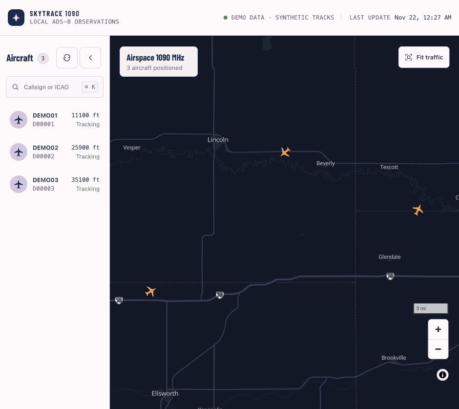
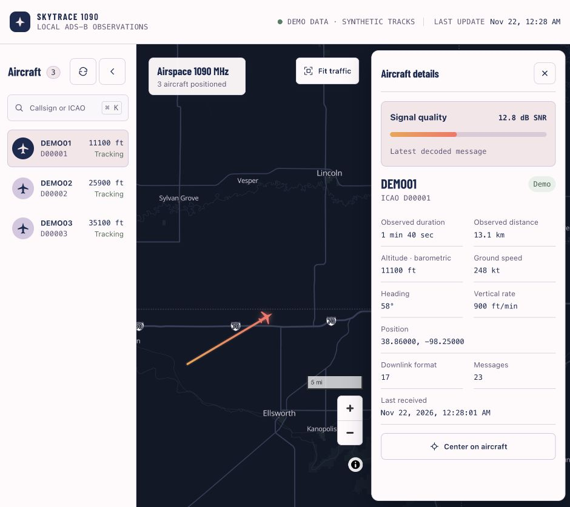
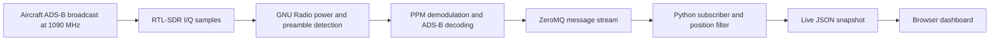

# SKYTRACE | Local Airspace

SKYTRACE is a receive-only ADS-B learning project. An RTL-SDR receives aircraft broadcasts on 1090 MHz, GNU Radio decodes the messages, a small Python subscriber collects aircraft observations, and a browser dashboard maps the positions received by the local antenna.

The map paths show reports actually received by this station. They are not complete flight routes and do not estimate positions between reports.





*Screenshots use fully synthetic demo traffic. Aircraft IDs, callsigns, positions, timestamps, and signal metrics are fabricated and do not represent real flights or the receiver location.*

## What it does

- Receives 1090 MHz ADS-B Extended Squitter using an RTL-SDR Blog V4L and dipole antenna.
- Uses a GNU Radio flowgraph and existing `gr-adsb` blocks for burst detection, demodulation, CRC checks, and supported field decoding.
- Collects decoded messages in Python and maintains a live JSON snapshot with accepted position observations.
- Shows aircraft markers, observed paths, and available decoded details in a custom MapLibre dashboard.
- Filters implausible short-interval position jumps and splits paths across long reception gaps.

The current receiver is tuned to 1090 MHz. It does not receive 978 MHz UAT. Callsign, position, altitude, velocity, and other supported fields may appear when transmitted and decoded. Aircraft model, airport origin, and destination are not provided by this decoder.

## How it works



The flowgraph is defined in `adsb_rx_rtlsdr.grc`; GNU Radio Companion generates `adsb_rx.py`. The ADS-B framer, demodulator, and decoder are supplied by the [`gr-adsb` GNU Radio extension module](https://github.com/mhostetter/gr-adsb). The custom collector and dashboard are `aircraft_stream.py` and `dashboard/`.

## Preview with demo data

The demo works without an SDR or GNU Radio. It uses entirely synthetic aircraft tracks and signal values, with timestamps rebased to the current time when loaded. It does not contain receiver observations or identify the receiver's location.

1. From the project folder, start a static web server:

   ```sh
   python3 -m http.server 8000
   ```

2. Open <http://localhost:8000/dashboard/?demo=1>.

For a preselected aircraft and its observed path, open <http://localhost:8000/dashboard/?demo=1&aircraft=D00001>.

The map style and map tiles load from the internet. Demo aircraft data is read from `examples/aircraft_snapshot_demo.json`.

## Run with an RTL-SDR

### Requirements

- macOS and an RTL-SDR Blog V4L with a suitable 1090 MHz antenna
- GNU Radio 3.10, `gr-adsb`, GNU Radio OsmoSDR, and `pyzmq` in one Python environment
- Internet access for the MapLibre library and background map tiles

Install a Radioconda environment or another environment containing the listed GNU Radio components. Copy `.flight-tracker.env.example` to `.flight-tracker.env` and set `FLIGHT_TRACKER_PYTHON` to the environment's Python executable. Then run `start_flight_tracker.command` from Finder or Terminal. The launcher starts the subscriber, generated flowgraph, and local web server.

To edit the receiver flowgraph, open `adsb_rx_rtlsdr.grc` in GNU Radio Companion and regenerate `adsb_rx.py` after making changes.

## Data and privacy

- `aircraft_snapshot_live.json` is generated on the receiver computer and is intentionally excluded from Git. It contains locally collected observations and may reveal the receiver's location.
- The subscriber keeps its track history in memory and rewrites the snapshot as reports arrive. It is not a permanent database; restarting the subscriber begins a fresh in-memory history.
- Demo data is synthetic and is not a live feed.
- Aircraft data is served locally in the live setup. Map library code and map tiles are loaded from external services.

## Repository layout

| File | Purpose |
| --- | --- |
| `adsb_rx_rtlsdr.grc` | GNU Radio Companion flowgraph definition |
| `adsb_rx.py` | Generated runnable GNU Radio flowgraph |
| `aircraft_stream.py` | ZeroMQ subscriber, position filtering, and JSON snapshot writer |
| `dashboard/` | Interactive aircraft map and details UI |
| `examples/aircraft_snapshot_demo.json` | Fully synthetic aircraft data for dashboard preview |
| `patches/` | Local compatibility fix for the installed `gr-adsb` decoder |
| `project_overview.md` | Learning plan and future milestones |
